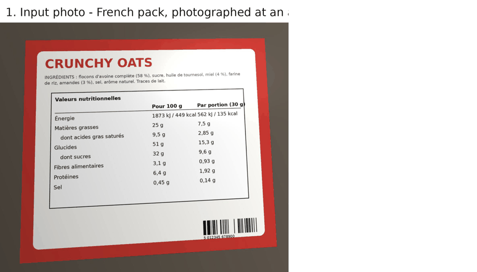
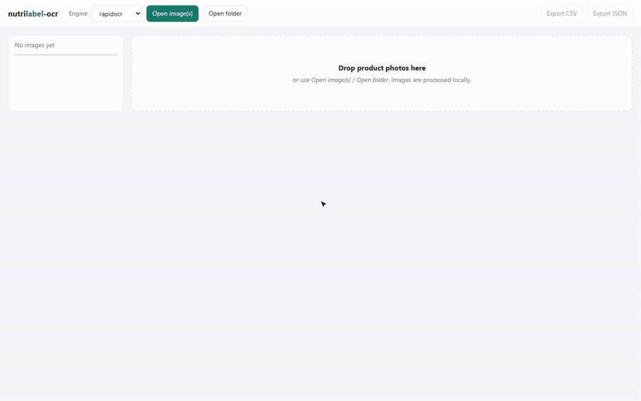
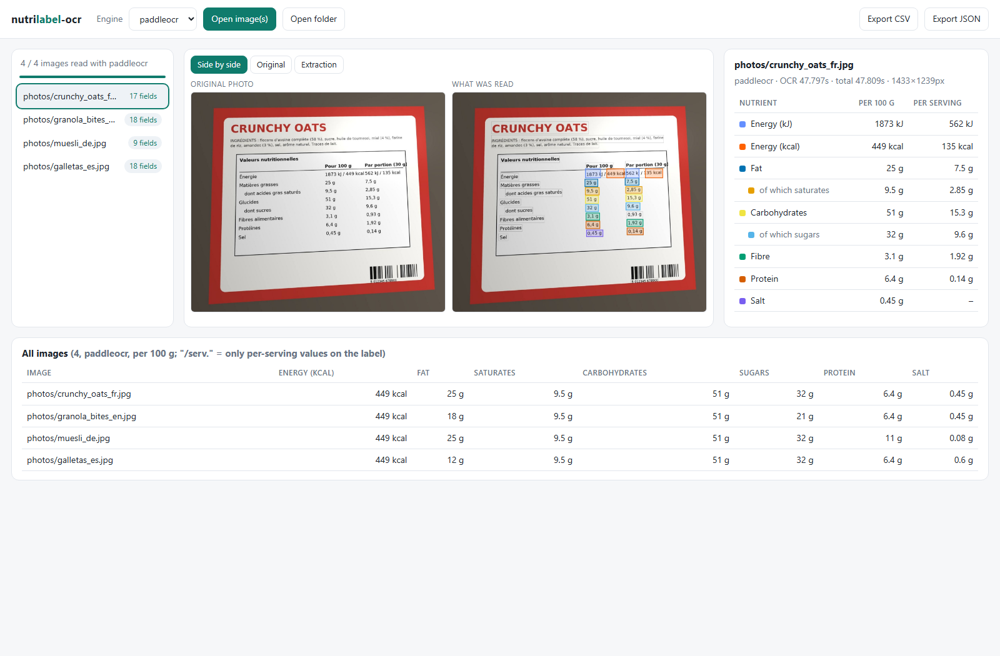
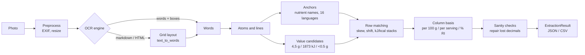
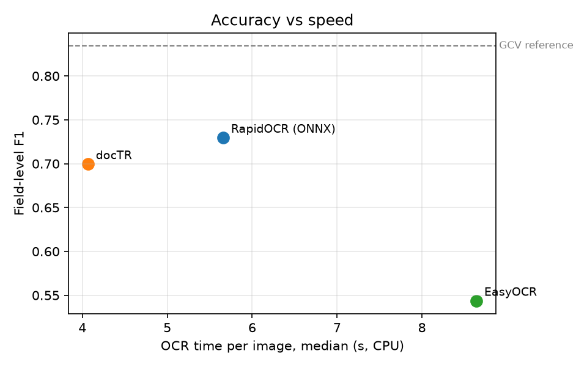
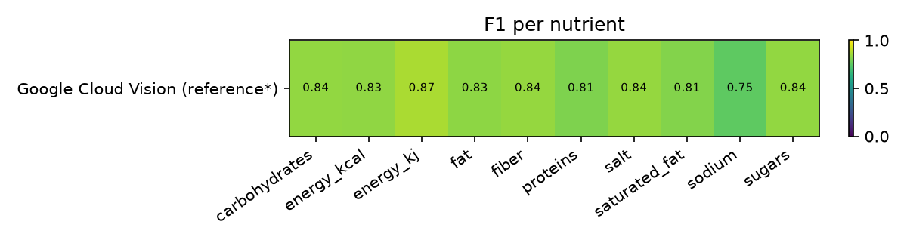
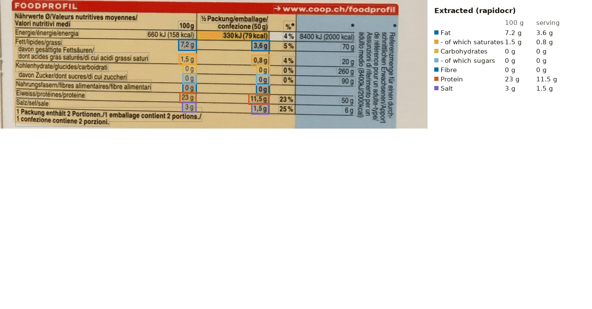

<div align="center">

# nutrilabel-ocr

**Read the nutrition facts table of any food product photo, with the OCR engine of your choice.**

[](https://github.com/karemdm/nutrilabel-ocr/actions/workflows/ci.yml)




<sub>Package photos rendered by the test suite and read by Tesseract, which misreads a few fields (16/18 and 15/18 correct on two of the packs); the benchmark numbers below are on real photos.</sub>

</div>

`nutrilabel-ocr` turns a photo of a food package into structured data:

```json
{"energy_kcal_100g": 449, "fat_100g": 25, "saturated_fat_100g": 9.5, "sugars_100g": 32,
 "proteins_100g": 6.4, "salt_100g": 0.45, "fat_serving": 7.5, "...": "..."}
```

It combines **interchangeable OCR engines** (from classic Tesseract to 2025-2026
vision-language OCR models such as PaddleOCR-VL, olmOCR-2 and GLM-OCR) with a
**layout-aware extractor** that understands nutrition tables (EU and US formats,
15+ languages, rotated photos, horizontal tables, running text). Every engine is
measured on the same **real-world benchmark**: ~3,000 crowd-sourced product photos
from [Open Food Facts](https://world.openfoodfacts.org/).

---

## Contents

- [Highlights](#highlights)
- [Interface](#interface)
- [Installation](#installation) · [Windows quick start](#windows-quick-start)
- [Usage](#usage): [CLI](#command-line-no-gui) · [Web interface](#web-interface) · [Python API](#python-api) · [Docker](#docker)
- [OCR engines](#ocr-engines)
- [How it works](#how-it-works)
- [Benchmark](#benchmark)
- [Output format](#output-format)
- [Project structure](#project-structure)
- [Development](#development)
- [Limitations](#limitations)
- [Acknowledgements and licences](#acknowledgements-and-licences)

## Highlights

| | |
|---|---|
| **15 OCR engines, one parameter** | `engine="paddleocr"`, `"rapidocr"`, `"surya"`, `"doctr"`, `"easyocr"`, `"tesseract"`, `"ultralytics"`, `"paddleocr-vl"`, `"olmocr"`, `"glm-ocr"`, `"chandra"`, `"nanonets-ocr"`, `"deepseek-ocr"`, `"qwen-vl"`, or any model behind a local Ollama / vLLM server (`"vlm"`). |
| **Real nutrition-table understanding** | Per-100 g vs per-serving columns, kJ/kcal stacked in one cell, "% reference intake" columns ignored, US *Nutrition Facts* panels, labels printed as a sentence, photos taken sideways, horizontal tables. |
| **Multilingual** | English, French, German, Spanish, Italian, Dutch, Portuguese (including Brazilian ANVISA tables with *Quantidade por porção* / *%VD*), Croatian, Slovenian, Czech, Polish, Hungarian, Danish, Swedish, Finnish, Romanian. |
| **Self-checking** | Nutritional sanity rules (saturated fat <= fat, sugars <= carbs, <= 100 g per 100 g, kJ ~ 4.184 x kcal) catch and repair typical OCR slips such as a lost decimal separator. |
| **Reproducible benchmark** | Field-level precision / recall / F1 and latency for every engine on the Open Food Facts test split, with charts and an annotated gallery. |
| **Run it your way** | CLI for single images or whole folders (CSV/JSON export), a local web interface, a Python API, or Docker. Images never leave your machine. |
| **Light core** | The core package needs only `numpy` and `Pillow`; each engine is an optional extra. |

## Interface

`nutrilabel ui` opens a local web page: pick **one image, several images or a whole
folder** (or drag and drop them) and choose the engine. Each photo is shown **side by side:
the original and what was read**, with every detected value highlighted in the colour of
its nutrient, next to the extracted table, the warnings raised by the sanity checks and the
timings. A summary table compares all images, and results export to CSV or JSON.

<p align="center"></p>

*The interface in use on six real Open Food Facts photos (CC BY-SA 3.0): reading with `rapidocr`, the three views, a second engine (`doctr`) for comparison and the CSV export. Reading is sped up in the recording.*

<p align="center"></p>

*The real interface, rendered by `scripts/make_ui_snapshot.py` on four rendered package
photos (PaddleOCR engine). Run `python scripts/make_ui_snapshot.py --images your/photos/*.jpg`
to render it on your own pictures.*

## Installation

Requires Python 3.9+.

Linux / macOS:

```bash
git clone https://github.com/karemdm/nutrilabel-ocr.git
cd nutrilabel-ocr
python3 -m venv .venv
source .venv/bin/activate
pip install -e ".[rapidocr]"          # light, fast, CPU-only: a good first engine
nutrilabel read samples/7613379505774.jpg --engine rapidocr   # try it on a bundled photo
```

Windows (PowerShell):

```powershell
git clone https://github.com/karemdm/nutrilabel-ocr.git
cd nutrilabel-ocr
python -m venv .venv
.venv\Scripts\Activate.ps1
pip install -e ".[rapidocr]"
```

Pick the engines you want; extras can be combined (`pip install -e ".[paddle,tesseract]"`):

| Extra | Engines | Notes |
|---|---|---|
| `rapidocr` | `rapidocr` | PP-OCR models on ONNX Runtime, CPU friendly, ~50 MB |
| `paddle` | `paddleocr` | PaddleOCR (PP-OCR); `lang="latin"` for accented text |
| `surya` | `surya` | Transformer OCR, 90+ languages |
| `doctr` | `doctr` | docTR (PyTorch) |
| `easyocr` | `easyocr` | EasyOCR (PyTorch) |
| `ultralytics` | `ultralytics` | Ultralytics OCR solution (YOLO26 text detector + PP-OCRv6 on ONNX Runtime); Python 3.11+, AGPL-3.0 |
| `tesseract` | `tesseract` | Also needs the binary: `apt install tesseract-ocr tesseract-ocr-fra ...` / `brew install tesseract` / [Windows installer](https://github.com/UB-Mannheim/tesseract/wiki) |
| `paddle-vl` | `paddleocr-vl` | PaddleOCR-VL document VLM, GPU recommended |
| `vlm` | `olmocr`, `glm-ocr`, `chandra`, `nanonets-ocr`, `deepseek-ocr`, `qwen-vl` | Hugging Face `transformers` + PyTorch, GPU strongly recommended (weights: 2-16 GB) |
| *(none)* | `vlm` | Any model served by Ollama / vLLM / LM Studio (OpenAI-compatible API) |
| `benchmark` | | `datasets` + `matplotlib`, to run the benchmark |
| `all` | all classic engines + benchmark tools | |

Check what is installed at any time:

```bash
nutrilabel engines
```

### Windows quick start

From the project folder, in a Command Prompt:

```bat
scripts\run_all.bat          :: install, tests, benchmark on 30 real photos, report, demo GIF, UI screenshot
scripts\run_all.bat full     :: same with the 199 test photos
scripts\publish.bat          :: commit and push to GitHub (create the empty repository first)
nutrilabel ui                :: open the web interface
```

Notes for Windows: the Tesseract binary comes from `winget install --id UB-Mannheim.TesseractOCR -e`;
PaddleOCR 3.x runs with oneDNN disabled on Windows CPUs (a known PaddlePaddle bug) and falls
back to another model automatically if a language model is not shipped with your version.

## Usage

The project can be used **with or without a graphical interface**. Each mode has its own
command and its own script at the repository root, so you can also run it without
installing the package (`python main_cli.py ...`, `python main_ui.py`).

| Mode | Installed command | Without installing |
|---|---|---|
| Command line | `nutrilabel read ...` | `python main_cli.py read ...` |
| Web interface | `nutrilabel ui` or `nutrilabel-ui` | `python main_ui.py` |
| Python module | `python -m nutrilabel read ...` | |

### Command line (no GUI)

```bash
# one image: prints a table
nutrilabel read label.jpg

# choose the engine and get JSON (add --with-ocr to include every OCR word)
nutrilabel read label.jpg --engine paddleocr --json

# save a visual check of what was read
nutrilabel read label.jpg --annotate label_checked.png

# a whole folder (recursive): one CSV row per image + one annotated PNG per image
nutrilabel read photos/ --csv results.csv --out-dir annotated/ --quiet
```

Example output:

```
label.jpg  (engine: rapidocr, OCR 0.41s)
  field                        value  unit
  carbohydrates_100g              51  g
  energy_kcal_100g               449  kcal
  energy_kj_100g                1873  kJ
  fat_100g                        25  g
  ...
```

| Option | Meaning |
|---|---|
| `-e, --engine` | Engine name or `auto` (best installed classic engine) |
| `--lang en,fr,de` | Languages passed to engines that need them (Tesseract, EasyOCR); default `en,fr,de,es,it,nl,pt` |
| `--json` / `--with-ocr` | JSON output / include raw OCR words |
| `--csv FILE` | One row per image with every supported field |
| `--out-dir DIR` / `--annotate PNG` | Save annotated images (`--annotate` takes a single input, `--out-dir` writes `<name>.annotated.png` per image) |
| `-q, --quiet` | Do not print the per-image table |
| `--version` | Print the version and exit (a global option: `nutrilabel --version`) |
| `--max-side N` | Longest image side sent to the OCR (default 1600 px) |
| `--no-rotate` | Disable the retry with the photo rotated by 90/270/180 degrees |

Exit status: `0` when every image gave at least one value, `1` when an image failed or had no values, `2` when no image was found or the options are invalid.

### Web interface

```bash
nutrilabel ui                          # opens http://127.0.0.1:8765 in your browser
nutrilabel ui --engine paddleocr --port 9000 --no-browser
```

Options: `-e/--engine` (preselected engine), `--host` (default `127.0.0.1`), `--port` (default `8765`), `--no-browser`.

- **Open image(s)**: one or several files. **Open folder**: every image in a folder (and sub-folders). Drag and drop also works.
- Click an image in the list to see it: **Side by side** (original + extraction), **Original** or **Extraction** only, plus the extracted table and warnings.
- **Switching the engine** shows the results of that engine. Images not read with it yet are marked *not run*, and a **Run &lt;engine&gt; on N images** button processes them (nothing heavy starts just by changing the menu). Results are kept per engine, and the image panel lists the other engines that already read it ("Also read with: rapidocr (16 fields), tesseract (12 fields)") so you can compare them in one click.
- Vision-language models are listed separately with a warning when no GPU is available.
- **Export CSV / JSON** downloads the results of every processed image.

The server uses only the Python standard library (no web framework), runs locally
and binds to `127.0.0.1` by default.

### Python API

```python
from nutrilabel import NutritionReader

reader = NutritionReader(engine="rapidocr")        # or "auto", "paddleocr", "olmocr", ...
result = reader.read("label.jpg")                   # path, bytes, PIL image or numpy array

result.as_simple_dict()      # {'energy_kcal_100g': 449.0, 'fat_100g': 25.0, ...}
result.nutrients["fat_100g"] # NutrientValue(value=25.0, unit='g', raw='25 g', bbox=..., confidence=...)
result.warnings              # e.g. ['saturated_fat_100g: 95 looked implausible ...']
result.to_dict()             # JSON-serialisable

from nutrilabel.imaging import draw_result
draw_result("label.jpg", result).save("checked.png")
```

Already have OCR output (from any tool)? Use the extractor alone:

```python
from nutrilabel import NutritionExtractor, OCRResult, Word, BBox
from nutrilabel.extraction import text_to_words

words = [Word("Fat", BBox(10, 100, 50, 120)), Word("3.2 g", BBox(300, 100, 360, 120))]
NutritionExtractor().extract(OCRResult(words, engine="mine")).as_simple_dict()
# {'fat_100g': 3.2}

# Markdown / HTML from a vision-language model works too
NutritionExtractor().extract(text_to_words("| Fat | 3.2 g |\n| Salt | 0.1 g |"))
```

### Docker

```bash
docker build -t nutrilabel .
docker run --rm -p 7860:7860 nutrilabel                          # web interface on :7860
docker run --rm -v "$PWD:/data" nutrilabel \
    nutrilabel read /data/photos --csv /data/results.csv          # CLI on a folder
```

The image ships Tesseract (7 languages) and RapidOCR.

## OCR engines

Should the project offer several engines or pick one? **Several, behind one parameter.**
There is no single best engine for every deployment: accuracy, speed, install size,
hardware (CPU vs GPU) and licence all trade off against each other. The benchmark below
measures those trade-offs on real photos, and `engine="auto"` follows the measured
ranking (classic engines only, so `auto` never downloads gigabytes of VLM weights).

| Engine | Family | Output | Hardware | Licence (code / weights) |
|---|---|---|---|---|
| `paddleocr` | PP-OCR detector + recogniser | lines + boxes | CPU / GPU | Apache-2.0 |
| `rapidocr` | PP-OCR models on ONNX Runtime | lines + boxes | CPU | Apache-2.0 |
| `surya` | transformer detector + recogniser | lines + boxes | CPU / GPU | GPL-3.0 / OpenRAIL-M (free for research and personal use) |
| `doctr` | DBNet/FAST + CRNN | words + boxes | CPU / GPU | Apache-2.0 |
| `easyocr` | CRAFT + CRNN | lines + boxes | CPU / GPU | Apache-2.0 |
| `tesseract` | LSTM | words + boxes | CPU | Apache-2.0 |
| `ultralytics` | YOLO26 oriented-box text detector + PP-OCRv6 recogniser (ONNX Runtime) | words + boxes | CPU / GPU | AGPL-3.0 |
| `paddleocr-vl` | document VLM (PaddleOCR-VL) | markdown | GPU recommended | Apache-2.0 |
| `olmocr` | VLM, `allenai/olmOCR-2-7B-1025` | markdown | GPU | Apache-2.0 |
| `glm-ocr` | VLM, `zai-org/GLM-OCR` | markdown | GPU | see model card |
| `chandra` | VLM, `datalab-to/chandra-ocr-2` | markdown | GPU | OpenRAIL (non-commercial use is fine) |
| `nanonets-ocr` | VLM, `nanonets/Nanonets-OCR2-3B` | markdown | GPU | see model card |
| `deepseek-ocr` | VLM, `deepseek-ai/DeepSeek-OCR-2` | markdown | GPU (vLLM recommended) | Apache-2.0 |
| `qwen-vl` | general VLM, `Qwen/Qwen2.5-VL-3B-Instruct` | markdown | GPU | see model card |
| `vlm` | any model on a local OpenAI-compatible server | markdown | your server | depends on the model |

The `ultralytics` engine picks its YOLO26 detector size with a suffix (`ultralytics:n`,
`:s`, `:m`, `:l`, `:x`; default `x`) or `get_engine("ultralytics", size="n", imgsz=1280)`. It needs
Python 3.11+, downloads its weights on first use, and is licensed AGPL-3.0, so check that
against your use case before shipping it.

Vision-language models return text rather than word boxes; `nutrilabel` lays that text
out on a grid so the same extractor and the same benchmark apply to every engine. Using
a local server:

```bash
ollama pull qwen2.5vl:7b
export NUTRILABEL_VLM_URL=http://localhost:11434/v1 NUTRILABEL_VLM_MODEL=qwen2.5vl:7b
nutrilabel read label.jpg --engine vlm
```

Only free, open-weight models are wired in; no paid API is called. More in
[docs/engines.md](docs/engines.md).

## How it works



1. **Words to atoms and lines.** Line-level boxes (PaddleOCR, RapidOCR, EasyOCR...) are split into word atoms with interpolated boxes, then grouped into text lines.
2. **Anchors.** A multilingual lexicon finds nutrient names ("Fat", "Matières grasses", "davon gesättigte Fettsäuren"...). Specific names are matched first ("saturated fat" is never read as "fat"), and rows we do not report (starch, polyols, vitamins...) are recognised so their values are not given to a neighbour.
3. **Values.** Numbers with units are parsed with OCR slips in mind: `Og` -> 0 g, `kl` -> kJ, `7,59` -> 7,5 g ("g" read as "9"), thousands separators in energy values.
4. **Row matching.** Each value is assigned to the label on its row (following the text baseline slope of skewed photos, stopping at the next label on the same row), with a second pass for labels printed slightly above or below their values.
5. **Columns.** Header cues ("100 g", "portion", "serving"...) decide which column is per 100 g and which is per serving; US panels are per serving; columns of bare small integers are treated as "% RI" and skipped; running text uses one basis for the whole label.
6. **Orientation.** Sideways photos (vertical word boxes) and horizontal tables (names side by side, values underneath) are read in a rotated / transposed frame.
7. **Sanity checks.** Implausible values are flagged and, when only a decimal separator was lost, repaired.

No training is required and every decision is explainable. Details: [docs/architecture.md](docs/architecture.md).

## Benchmark

**Dataset.** [`openfoodfacts/nutrient-detection-layout`](https://huggingface.co/datasets/openfoodfacts/nutrient-detection-layout)
(CC-BY-SA 3.0): ~3,000 real product photos from Open Food Facts with every nutrient value
annotated (2,884 train / 199 test). The photos are as messy as real life: phone pictures,
curved packs, glare, many languages.

**Metric.** For each image, every predicted field (`fat_100g`, `energy_kcal_serving`, ...)
is compared with the annotation (1 % tolerance, mg/g normalised). A wrong value counts as
a false positive *and* a false negative. We report field-level precision, recall and F1,
the share of labels read perfectly, how many annotated numbers the OCR saw at all, and
OCR latency.

### Results (test split)

| Engine | F1 | Precision | Recall | Perfect labels | OCR value recall | OCR s/img |
|---|---:|---:|---:|---:|---:|---:|
| Reference OCR (Google Cloud Vision tokens shipped with the dataset)* | **0.834** | 0.887 | 0.787 | 41.9 % | 98.0 % | - |
| `rapidocr` (ONNX, CPU) | **0.730** | 0.856 | 0.636 | 17.6 % | 88.3 % | 5.7 |
| `doctr` | 0.699 | 0.808 | 0.617 | 18.1 % | 80.6 % | 4.1 |
| `easyocr` | 0.544 | 0.677 | 0.454 | 6.0 % | 52.3 % | 8.6 |
| `paddleocr`, `surya`, `tesseract` | run `make benchmark` | | | | | |
| `paddleocr-vl`, `olmocr`, `glm-ocr`, `chandra`, ... (GPU) | run `python -m benchmark.run --engines all-vlm` | | | | | |

\* The reference row feeds the dataset's own OCR tokens to the extractor, so it measures
the **extraction** quality with near-perfect OCR: about 4 out of 5 annotated values are
recovered, with ~89 % precision, on real photos, without any training. The extractor was
tuned on the train split only; the test split was held out. The open-source rows were run
on CPU (OCR time is the median per image); the light `rapidocr` engine gets closest to the
reference. Other engines can be added by running the benchmark on your machine (it downloads
650 MB of images and the engines' models), which also updates
[docs/benchmark_results.md](docs/benchmark_results.md) and the charts below.

<p align="center"></p>

<p align="center"></p>

Real photos from the test split read by `rapidocr` (values highlighted in the colour of their nutrient):

<p align="center"></p>

<sub>Photos: Open Food Facts contributors, via the `openfoodfacts/nutrient-detection-layout` dataset (CC BY-SA 3.0).</sub>

Reproduce everything:

```bash
pip install -e ".[benchmark,rapidocr,paddle,tesseract]"   # + the engines you want to compare
make benchmark          # python -m benchmark.run  (OCR results are cached)
make report             # tables + charts + annotated gallery + docs/assets/real_examples.gif
```

Quick checks: `python -m benchmark.run --engines rapidocr,tesseract --limit 30`.
Method details and caveats: [docs/benchmark.md](docs/benchmark.md).

## Output format

`result.to_dict()` / `--json`:

```json
{
  "nutrients": {
    "fat_100g": {"key": "fat_100g", "value": 25.0, "unit": "g", "raw": "25 g",
                 "bbox": [521.0, 177.0, 599.0, 200.0], "confidence": 0.96, "qualifier": ""},
    "salt_100g": {"key": "salt_100g", "value": 0.5, "unit": "g", "raw": "<0,5 g",
                  "bbox": [521.0, 470.0, 599.0, 495.0], "confidence": 0.93, "qualifier": "<"}
  },
  "warnings": [],
  "engine": "rapidocr",
  "ocr_elapsed_s": 0.41
}
```

Supported fields: `energy_kj`, `energy_kcal`, `fat`, `saturated_fat`, `carbohydrates`,
`sugars`, `fiber`, `proteins`, `salt`, `sodium`, each with the suffix `_100g` or `_serving`.
`bbox` is in original-image pixels; text-only VLM engines have no real positions (their boxes lie on a synthetic grid).

## Project structure

```
nutrilabel-ocr/
├── src/nutrilabel/
│   ├── engines/          # OCR engine registry and adapters
│   │   ├── base.py       #   OCREngine interface
│   │   ├── classic.py    #   PaddleOCR, RapidOCR, Surya, docTR, EasyOCR, Tesseract, Ultralytics
│   │   └── vlm.py        #   PaddleOCR-VL, olmOCR, GLM-OCR, Chandra, ... and local servers (also the generic `hf-vlm` class)
│   ├── extraction/       # words -> nutrients
│   │   ├── extractor.py  #   layout-aware matching (rows, columns, orientation)
│   │   ├── layout.py     #   word splitting and line grouping
│   │   ├── nutrients.py  #   multilingual lexicon and header cues
│   │   ├── parsing.py    #   numbers, units, OCR slips
│   │   ├── validation.py #   nutritional sanity checks
│   │   └── markup.py     #   markdown/HTML (VLM output) -> word grid
│   ├── imaging/          # image loading, resizing, visualisation
│   ├── evaluation/       # ground truth, metrics, synthetic labels for tests
│   ├── ui/               # local web interface (server + single HTML page)
│   ├── pipeline.py       # NutritionReader: image -> ExtractionResult
│   ├── cli.py            # `nutrilabel` command
│   └── types.py          # BBox, Word, OCRResult, NutrientValue, ExtractionResult
├── benchmark/            # run.py, report.py, data.py, results/summary.json (raw per-image outputs are git-ignored)
├── samples/              # 6 example product photos (sources in samples/README.md)
├── tests/                # pytest suite + 40 annotated real labels (fixtures)
├── scripts/              # make_demo.py (GIF), make_ui_snapshot.py (screenshot), run_all.bat / publish.bat (Windows)
├── docs/                 # architecture, engines, benchmark, benchmark_results, assets
├── main_cli.py           # run the CLI without installing
├── main_ui.py            # run the web interface without installing
├── Dockerfile, Makefile, pyproject.toml
└── .github/workflows/    # CI (lint + tests) and manual benchmark workflow
```

## Development

```bash
pip install -e ".[dev]"      # pytest, ruff, pytesseract
make test                    # unit + end-to-end tests (end-to-end ones need Tesseract)
make lint                    # ruff
make demo                    # regenerate docs/assets/demo.gif
```

The test-suite covers parsing, every layout scenario of the extractor (EU/US tables,
running text, rotated and horizontal layouts, % columns), every engine adapter (with
mocked raw outputs), the VLM path against a fake local server, the web server, the CLI
folder mode, and a regression guard on 40 real annotated labels. Contributions are
welcome, see [CONTRIBUTING.md](CONTRIBUTING.md).

## Limitations

- The extractor is rule-based: unusual layouts (values printed *left* of the names, tables split over two panels, heavily curved packs) can be missed. Warnings in the result tell you when something looks off.
- Ten nutrients per 100 g / per serving are extracted; serving size, vitamins and minerals are not reported yet.
- Vision-language engines give no word positions, so their results cannot be highlighted on the photo.
- OCR quality dominates the end result; check the benchmark before choosing an engine, and review extracted values before using them for anything that matters (diet, health or compliance decisions).

## Acknowledgements and licences

- Code: [MIT](LICENSE).
- Benchmark data and the test fixtures in `tests/fixtures/`: [Open Food Facts](https://world.openfoodfacts.org/) contributors, [CC-BY-SA 3.0](https://creativecommons.org/licenses/by-sa/3.0/) ([dataset card](https://huggingface.co/datasets/openfoodfacts/nutrient-detection-layout)).
- OCR engines and models belong to their authors and keep their own licences (table above); some model weights restrict commercial use. This repository is a non-commercial research / portfolio project.
- All code is covered by the test-suite; please report any issue.
