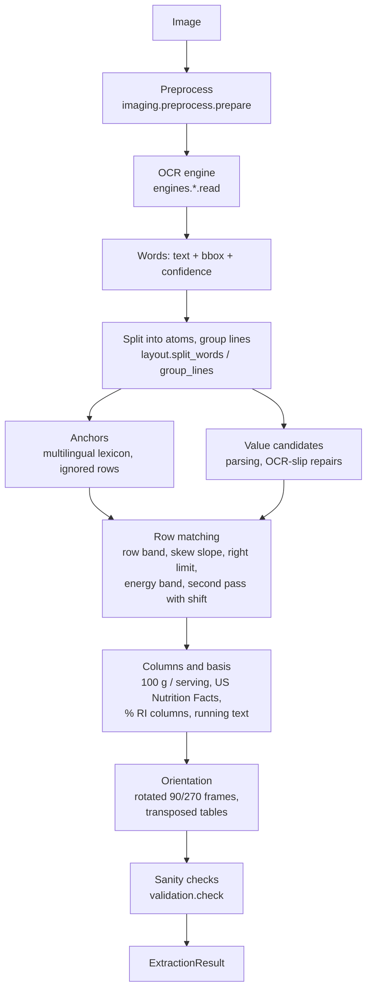

# How the extractor works

`nutrilabel-ocr` turns a product photo into structured nutrient values. The OCR engine only supplies words with bounding boxes; everything after that is deterministic, rule-based Python (`src/nutrilabel/extraction/`). No model is trained and every decision can be traced to a function and a warning message.

## Overview

The high-level entry point is `NutritionReader` (`pipeline.py`); the extraction logic is `NutritionExtractor.extract` in `extraction/extractor.py`. The orientation step wraps the others: `extract` calls `_extract_words` once per candidate rotation and keeps the richest result.

## Preprocess and OCR

`imaging.preprocess.prepare` loads the image (path, bytes, PIL image or array), applies EXIF orientation, converts to RGB and rescales: photos whose longest side exceeds `max_side` (default 1600 in `NutritionReader`) are shrunk, and images whose shortest side is under 400 px are enlarged 2x. The scale factor is kept so that boxes are mapped back to original-image coordinates.

The engine (see [engines.md](engines.md)) returns `Word(text, bbox, confidence)` objects. Engines differ in granularity: Tesseract and docTR return words, others return whole text lines. The extractor does not care, because the next step normalises both.

If fewer than `min_fields` (default 2) nutrients are found, `NutritionReader.read` re-runs OCR on the image rotated by 90, 270 and 180 degrees and keeps the best reading.

## Atoms and lines

`layout.split_words` splits every box into single-token *atoms*. It splits on whitespace, `/` and `|`, and between a label and a glued number (`Energia:1840`, `KJ-440`). The horizontal extent of each atom is interpolated from its character offsets inside the original box.

`layout.group_lines` groups atoms greedily by vertical overlap (an atom joins a line when its centre is within half the line's text height) and returns lines sorted top to bottom, atoms left to right. `median_height` of all atoms is used as the unit `h` for every tolerance that follows, so the extractor is scale-independent.

## Anchors

`_find_anchors` runs the regexes in `nutrients.NUTRIENTS` on each line after `normalize_text` (lower case, accents stripped, `ss` for the German eszett). Lines matching `NOISE_LINE` (reference intake notes, ingredient lists) are skipped. The lexicon covers many languages per nutrient, for example `Matieres grasses`, `Kohlenhydrate`, `Brennwert`, `verzadigde vetzuren`.

Order matters: more specific patterns run first and consume their character span, so "saturated fat" is not also read as "fat" and "of which sugars" is not read as "carbohydrates". A special `IGNORED` entry recognises rows the library does not report (monounsaturated, trans fat, starch, cholesterol, calcium, vitamins, lactose, added sugars and others) so that their values are not handed to a neighbouring nutrient. Adjacent anchors of the same nutrient (`Fat / Matieres grasses`) are merged into one unless a number sits between them. For energy, `_energy_hint` records whether the label itself names `kJ` or `kcal`.

## Value candidates

`_find_values` parses every atom with `parsing.parse_value`, which handles decimal commas, thousands separators (`1.873 kJ`), qualifiers (`<0.5 g`, `less than`), unit aliases (`gr`, `mcg`, `kj`) and common OCR digit confusions (`Og` read as `0 g`, `O`, `l`, `I`, `S` inside a number). A bare unit atom directly to the right of a number is merged into it (`4,5` + `g`). Values in `%` or `ml` are dropped, and a bare `100` on a header line ("per 100 g") is dropped so it is not mistaken for a value.

`_repair_g_as_9` fixes the classic slip where `7,5 g` is read as `7,59`. It only applies to unit-less values that end in a 9 after two or more decimals, and only when either at least three values on the label carry an explicit `g`/`mg` unit that make up 60 % or more of the unit-bearing values, or the slip is systematic (at least three such suspects, 60 % or more of the unit-less decimals).

## Row matching

`_match_rows` pairs anchors with values in `_assign`, a greedy one-to-one assignment ordered by vertical distance. `_candidates` defines which values qualify for an anchor:

- **Row band:** the value centre must be within `row_tolerance` (default 0.65) times the larger of `h` and the anchor height.
- **Skew slope:** `_estimate_slope` takes the median baseline slope between neighbouring atoms of a line (needs at least 5 samples and a magnitude over 0.01). The vertical position of a value is corrected by `slope * dx` from the label, so tilted photos still line up.
- **Right limit:** the value must start right of the label and end before the next anchor on the same row. This separates side-by-side multilingual tables and running text.
- **Unit compatibility:** `kJ`/`kcal` values only go to energy anchors, and energy anchors accept only `kJ`, `kcal` or bare numbers.
- **Energy band:** kJ and kcal are often stacked in one cell, so energy anchors use a taller band (up to 2.2 times the tolerance below, 1.8 above), clipped by neighbouring anchors. Their values are collected left to right and sorted out in `_emit` (explicit units first, then the label hint, then the kJ/kcal ratio of about 4.184 for bare numbers).

Values are grouped into x-intervals (`_columns`); a column must be supported by at least two rows or it is treated as stray numbers. After the first pass, the median vertical offset between labels and matched values is computed. If it exceeds `0.15 * h`, a **second pass** retries the still-unmatched anchors with that shift, for labels printed slightly above or below their values.

## Columns and basis

`_column_bases` decides what each value column means, as one of `100g`, `serving`, `pct` or `skip`:

- **Header cues.** Lines above the table are scanned for `HEADER_100G` (`100 g`, `100 ml`, a bare `100`) and `HEADER_SERVING` (`serving`, `portion`, `porzione`, `porcao`, `per bar` and so on). Each cue votes for the nearest column by x position, within a distance limit; each column keeps its nearest cue. Two columns never share a basis. Without cues the default is `100g`, then `serving`.
- **US Nutrition Facts.** If `USDA_MARKERS` match ("Nutrition Facts", "Amount per serving", "% DV") and no 100 g cue exists, column 0 is `serving` and the remaining column is skipped (it would be per container).
- **% RI columns.** A non-first column of unit-less small integers (at most 100) is flagged by `_looks_like_pct` and labelled `pct`, which is not reported. Values carrying `%` are already dropped in `_find_values`.
- **Running text mode.** When matched values do not line up in columns (`_inline` is set if fewer than 70 % sit in their expected column rank), the label is treated as prose: the first value after each label gets one basis taken from the wording, the second the other basis.

`_emit` then produces keys such as `fat_100g` or `energy_kcal_serving`. When two candidates compete for one key, the one with the smaller vertical distance wins; confidence is multiplied by 0.8 when that distance is 0.5 text heights or more.

## Orientation

Two separate mechanisms handle geometry.

**Rotated frames.** `_vertical_ratio` measures how many words of 3+ characters are much taller than wide (engines that keep page orientation return such boxes for sideways photos). If the ratio is above 0.5, the order tried is 90, 270, 0 degrees; above 0.3, it is 0, 90, 270; otherwise only 0. `_rotate_words` rewrites coordinates so the text runs left to right, and the candidate with the most nutrients wins. Boxes are mapped back with `_rotate_box_back`, and a warning notes the rotation.

**Transposed tables.** If some line holds three or more anchors (names side by side, values underneath), `_extract_words` swaps x and y for anchors, values and lines, re-runs `_match_and_emit`, and adopts that result only if it finds at least two more nutrients than the normal reading. A warning notes the horizontal layout.

## Sanity checks

`validation.check` (run when `validate=True`, the default) applies three rules:

1. No mass nutrient exceeds 100 g per 100 g.
2. Saturated fat is at most fat, and sugars at most carbohydrates (2 % plus 0.05 g tolerance).
3. kJ and kcal agree within 8 % of the 4.184 ratio.

When a value breaks rule 1 or 2, has no decimal separator and is at least 10, dividing by 10 (then 100) is tried; if that satisfies the rule the value is repaired, its confidence is multiplied by 0.7, and a warning is added. Otherwise only a warning is added and confidence is halved. Rule 3 only warns. The result is an `ExtractionResult` with `nutrients`, `warnings` and the `ocr` result attached.

## Text-only VLM output

Vision-language models return markdown, HTML tables or plain lines, not word boxes. `extraction.markup.text_to_words` lays that text out on a synthetic grid so the same extractor runs unchanged:

- Rows come from HTML `<tr>` elements, markdown pipe tables (separator rows like `|---|---|` are dropped) or plain lines. HTML tags are stripped and entities unescaped.
- Row `i` is placed at `y = i * 30`, each word box is 20 high and 10 wide per character.
- In table rows, cell `j` starts at the same x in every row: column widths are the longest cell in that column, separated by a gap of 40. Value columns therefore line up as on the printed label. Non-table lines start at x = 0.

The boxes are not image coordinates (the engines set `boxes_are_synthetic`), so annotated overlays are not available for these engines. The reply `NONE` is treated as "no table found" and yields no words.

## Known limitations

These follow from what the code does and does not implement.

- **Mirrored layouts.** Values must be to the right of their label (`_candidates` rejects values left of the anchor). Right-to-left layouts or tables with values left of labels are not matched.
- **Curved or distorted packaging.** There is no unwarping. Only a constant, linear skew (one median slope for the whole image) and 90/270 degree frames are handled. Curved text, strong perspective or mixed orientations on one label are not.
- **Unusual line splits.** Values are matched by vertical position within a band. A value wrapped onto a separate line, far from its label, or a label split over several lines can be missed. The energy band is the only one widened for stacked cells; the vertical-shift second pass assumes a constant offset.
- **Fixed output schema.** Only 10 nutrients (`energy_kj`, `energy_kcal`, `fat`, `saturated_fat`, `carbohydrates`, `sugars`, `fiber`, `proteins`, `salt`, `sodium`) in 2 bases (`100g`, `serving`), 20 keys in total (`SUPPORTED_KEYS`). Other nutrients are recognised only to be ignored.
- **Serving size is not extracted.** The extractor can tell a serving column from a 100 g column but does not read the serving weight itself, and does not convert between bases.
- **Two columns at most.** `max_columns` defaults to 2; a third basis column (for example per container) is skipped.
- **Language coverage is lexical.** Labels in a language or spelling not covered by the regexes in `nutrients.py` produce no anchors ("no nutrient labels found").
- **Heuristic repairs can be wrong.** The decimal-separator repair and the `g`-read-as-`9` repair are guesses; check `warnings` and `confidence` before trusting repaired values.
- **VLM output is only as structured as the model's text.** If a model reorders or merges columns, the synthetic grid reproduces that.

Output from this library is a suggestion produced from OCR and heuristics, not a validated reading; verify values that matter against the physical label.
