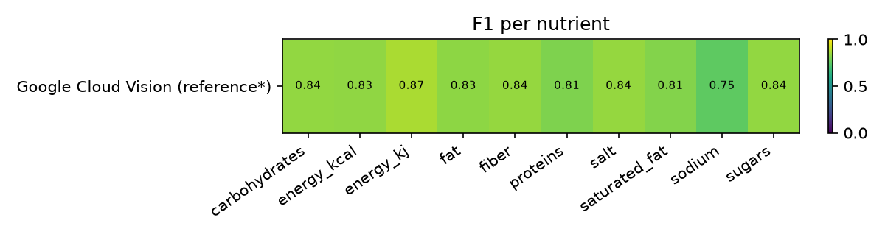

# Benchmark

The benchmark runs every OCR engine end to end (photo, OCR, extractor) on real product photos and scores the extracted fields against human annotations. Code: `benchmark/run.py`, `benchmark/report.py`, `benchmark/data.py`; metrics: `src/nutrilabel/evaluation/metrics.py`.

## Dataset

- **Source:** [`openfoodfacts/nutrient-detection-layout`](https://huggingface.co/datasets/openfoodfacts/nutrient-detection-layout) on Hugging Face (`DATASET_ID` in `benchmark/data.py`).
- **Licence:** CC-BY-SA 3.0 (images and annotations), by Open Food Facts contributors.
- **Content:** about 3,000 real product photos from Open Food Facts. Splits: `train` 2,884 images, `test` 199 images. The benchmark uses `test` by default (`--split train` is available).
- **Annotations:** BIO token labels such as `B-FAT_100G` / `I-FAT_100G` over the dataset's own OCR tokens, which come from Google Cloud Vision, together with normalised 0-1000 token boxes.
- **Download:** the Hugging Face loader fetches about 650 MB on first use (comment in `iter_hf`).

## What is scored

Only keys in `SUPPORTED_KEYS` (`extraction/nutrients.py`) are scored: 10 nutrients in 2 bases, 20 fields.

| Nutrient | Keys |
|---|---|
| energy (kJ) | `energy_kj_100g`, `energy_kj_serving` |
| energy (kcal) | `energy_kcal_100g`, `energy_kcal_serving` |
| fat | `fat_100g`, `fat_serving` |
| saturated fat | `saturated_fat_100g`, `saturated_fat_serving` |
| carbohydrates | `carbohydrates_100g`, `carbohydrates_serving` |
| sugars | `sugars_100g`, `sugars_serving` |
| fibre | `fiber_100g`, `fiber_serving` |
| proteins | `proteins_100g`, `proteins_serving` |
| salt | `salt_100g`, `salt_serving` |
| sodium | `sodium_100g`, `sodium_serving` |

Annotated spans for other labels in the dataset are ignored. `gold_from_bio` turns each tagged span into one gold field (joined tokens, first number and unit via `first_number`); if a key is annotated twice, the first occurrence wins.

## Metrics

All definitions are as implemented in `evaluation/metrics.py`.

- **Field-level precision, recall and F1.** For each document, every predicted key is compared with the gold fields (`score_document`).
  - TP: the key is in gold and the value matches.
  - FP: the key is predicted but absent from gold, or present with a wrong value.
  - FN: a gold key that is not a TP (missed, or wrong value).
  - A wrong value therefore counts as one FP and one FN. Counts are summed over all documents (micro-average); precision = TP/(TP+FP), recall = TP/(TP+FN), F1 is their harmonic mean. Per-nutrient F1 uses the same counts grouped by nutrient (both bases together).
- **Numeric match** (`values_match`). Mass values are converted to grams (`mg` / 1000, `ug` / 1,000,000), so `390 mg` equals `0.39 g`. Two values match when `math.isclose(pred, gold, rel_tol=0.01, abs_tol=0.0051)`: within 1 % relative or 0.0051 absolute. Energy values are compared as given (kJ with kJ, kcal with kcal, by key). Units on mass values are not otherwise compared.
- **Perfect-label rate.** Share of documents with no FP and no FN (`DocScore.perfect`). A document with no gold fields and no predictions counts as perfect.
- **OCR value recall** (`add_value_recall`). An OCR-only metric: for every gold field, is its numeric value present anywhere in the OCR text as a number (regex `\d{1,5}([.,]\d{1,3})?`, comma read as decimal point, `Og` read as `0g`, tolerance 1e-6)? It does not check position or label, so it estimates how much the OCR stage could at best deliver to the extractor.
- **Latency** (`evaluate_engine`). OCR time per image (`OCRResult.elapsed_s`, which is the time spent in `engine.read`): median, and p90 as the value at index `int(0.9 * (n - 1))` of the sorted list. Cached results keep the stored time. Also recorded: `wall_time_s` for the whole run and `errors` (images where an exception occurred; they score as all gold fields missed).

## The `gcv` reference run

The `gcv` entry (`REFERENCE` in `run.py`) does not run any OCR. It feeds the dataset's own Google Cloud Vision tokens and boxes (`words_from_dataset`) to the extractor. Because the annotators labelled those tokens, OCR errors are almost absent, so this row measures the extractor and the annotation scheme in isolation: it is the ceiling the extractor reaches with near-perfect OCR, not the performance of a commercial service. Engine rows are expected to be below it. It has no latency (`null` in `summary.json`).

The reference tokens still contain some OCR slips (see the next section), which is why the gold values are normalised.

## Gold normalisation

The dataset's tokens inherit the slips of the reference OCR. Left uncorrected, an engine that reads the label correctly would be scored as wrong. `gold_from_bio` therefore applies two corrections to the gold values:

1. **`g` read as `9`.** A tagged token such as `0,49` (printed `0,4 g`) with no unit and a pattern `<number with decimals>9` is read as `0.4 g` (`_G_AS_9`). This mirrors the extractor's own `_repair_g_as_9`.
2. **Physical plausibility.** `_physically_plausible` runs the same `validation.check(repair=True)` as the extractor on the gold fields. A lost decimal separator (`42,9 g` tagged as `429`) gives an impossible value such as 429 g of fat per 100 g; it is corrected to 42.9 by the rules in `validation.py` (at most 100 g per 100 g, saturated fat at most fat, sugars at most carbohydrates).

Both corrections are applied to the reference, so the benchmark compares engines on the true label content rather than on the reference OCR's mistakes. The consequence is that the extractor and the gold share some logic; the `gcv` row is a consistency check of that logic as much as an independent measurement.

## Reproduce

Install the extra, then run from the repository root:

```bash
pip install -e '.[benchmark]'        # datasets, matplotlib
pip install -e '.[rapidocr]'          # plus any engine extras you want to compare
```

```bash
# every installed classic engine + the gcv reference, full test split
python -m benchmark.run

# quick check: two engines, 30 images
python -m benchmark.run --engines rapidocr,tesseract --limit 30

# vision-language models (GPU recommended)
python -m benchmark.run --engines paddleocr-vl,olmocr,glm-ocr

# every installed VLM engine
python -m benchmark.run --engines all-vlm

# offline: reference only, from a token dump (no images needed)
python -m benchmark.run --engines gcv --jsonl tests/fixtures/off_sample.jsonl

# tables and charts from the results
python -m benchmark.report
python -m benchmark.report --gallery 6      # plus annotated real examples and a GIF
```

`run.py` options:

| Option | Default | Meaning |
|---|---|---|
| `--engines` | `all` | Comma list of engine names (including `gcv`), or `all` (the `gcv` reference plus installed classic engines) or `all-vlm` (installed VLM engines) |
| `--split` | `test` | `train` or `test` |
| `--limit N` | none | Only the first N images |
| `--jsonl PATH` | none | Token-only dump instead of the Hugging Face dataset; only `gcv` can run on it |
| `--max-side` | `1600` | Longest image side fed to the OCR engine |
| `--out` | `benchmark/results` | Output directory |

OCR output is cached per engine and image under `benchmark/results/ocr/<engine>/<idx>.json` (`idx` zero-padded to five digits). Re-running reads the cache, so extractor changes can be re-scored without repeating OCR; delete the folder to force fresh OCR (and fresh latency). Existing entries in `summary.json` for other engines are kept when you run a subset.

`report.py` options: `--results` (default `benchmark/results`), `--docs` (default `docs`), `--gallery N` and `--gallery-engine` (defaults to the best non-reference engine). It prints a recommended `PREFERENCE` order for `src/nutrilabel/engines/__init__.py`. The gallery skips engines without real boxes (text-only VLMs).

## Outputs

| File | Written by | Content |
|---|---|---|
| `benchmark/results/summary.json` | `run` | Metrics per engine |
| `benchmark/results/<engine>/predictions.jsonl` | `run` | Per image: gold, prediction, TP/FP/FN keys, OCR seconds, warnings, or the error |
| `benchmark/results/ocr/<engine>/<idx>.json` (`idx` zero-padded to five digits) | `run` | Cached OCR words |
| `docs/benchmark_results.md` | `report` | Results table |
| `docs/assets/per_nutrient_f1.png` | `report` | Heatmap of F1 per nutrient and engine |
| `docs/assets/f1_vs_latency.png` | `report` | F1 against median OCR time; drawn only if some engine has a latency |
| `docs/assets/examples/*.jpg`, `docs/assets/real_examples.gif` | `report --gallery` | Annotated real examples |

## Current results

Source: `benchmark/results/summary.json`, `test` split. The full table (every engine that has been run, with the latency column) is generated into [benchmark_results.md](benchmark_results.md) by `python -m benchmark.report`, and the per-nutrient chart is `assets/per_nutrient_f1.png`; this page does not repeat the numbers so they cannot drift apart.

Engines without a row there have not been run yet: run `python -m benchmark.run --engines <name>` with the engine installed, then `python -m benchmark.report`. The reference row measures the extractor with the dataset's own OCR tokens (see above), so do not read it as the accuracy of any OCR engine.

`summary.json` records 198 documents for the reference run and 199 for the engine runs, while the dataset lists 199 test images; the files are reported as written.



Results are a measurement on a small test split (about 200 images) and carry sampling uncertainty; small differences between engines may not be meaningful.
